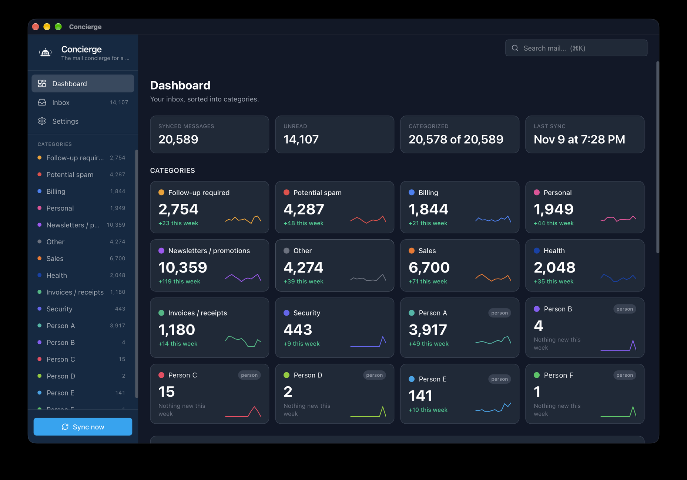
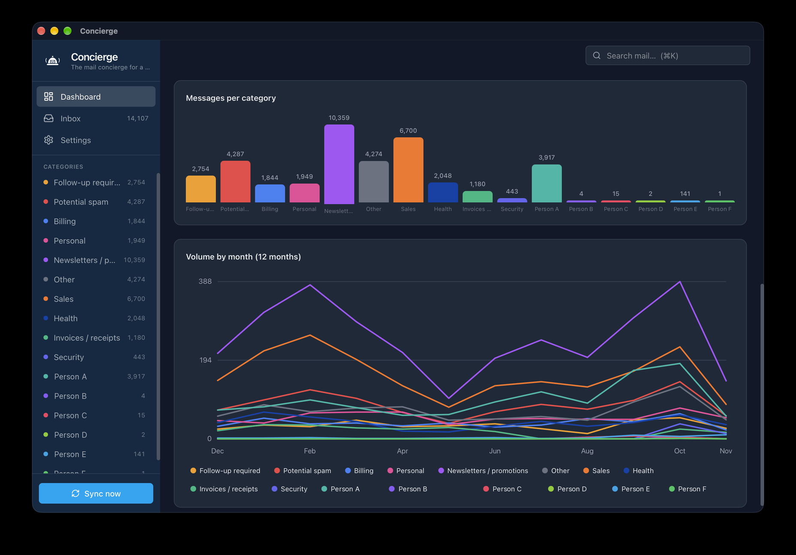

# Concierge

**The mail concierge for a crowded inbox.**


Concierge is a macOS app for anyone with a Gmail inbox that has gotten out of hand.
It reads your mail, uses AI to sort every message into categories — *Follow-up
required*, *Billing*, *Potential spam*, *Newsletters*, the people your mail is about,
and more — and gives you a dashboard of what's there and what's new, so you can
work through the backlog instead of scrolling through it.

It is **strictly read-only**: Concierge never deletes, moves, archives, labels, or
marks anything as read in Gmail. Your mail is stored only on your Mac.





<sub>Names of people in the screenshots have been replaced with Person A–F.</sub>

---

## What it does

- **Sorts your inbox for you** — every message is classified into one or more
  topic categories (*Follow-up required, Potential spam, Billing, Sales, Health,
  Personal, Newsletters / promotions, Invoices / receipts, Security, Other*). Add,
  rename, recolor, merge, or delete categories to fit how you think.
- **Groups mail by the people it's about** — AI finds who each email is *about*
  (not just who sent it). The 10 most-mentioned people get their own categories
  automatically; add more yourself.
- **Shows what's new** — each category card shows its total, how many arrived
  this week, and a 12-month trend line. Charts show volume per category and
  month by month.
- **Summarizes on demand** — expand any message and click **Summarize** for a
  two-sentence summary: what it is and whether it needs follow-up.
- **Finds anything fast** — search across sender, subject, and message text
  (⌘K), with matches highlighted.
- **Lets you correct it** — remove a message from a category with **×**, or add
  it to another with **+**.
- **Never touches your Gmail** — connects over IMAP in read-only mode
  (`EXAMINE` + `BODY.PEEK`), so nothing is ever flagged, moved, marked read, or
  deleted. Messages you delete in Gmail disappear from Concierge on the next sync.
- **Syncs incrementally** — the first sync pulls in your whole inbox with live
  progress and a **Cancel** button; later syncs fetch only new mail. Everything
  resumes where it left off, even after quitting.

---

## Tech stack

| Layer | Technology |
|---|---|
| Shell | Tauri v2 (Rust) — macOS desktop |
| Frontend | React 19 + TypeScript + Vite |
| Styling | Tailwind CSS v4 (light / dark / automatic) |
| State | Zustand |
| DB | SQLite via `tauri-plugin-sql` |
| Settings | JSON store via `tauri-plugin-store` |
| HTTP | `tauri-plugin-http` (all `https://` calls) |
| Charts | hand-rolled SVG (bar + multi-line trend) |
| AI | **Jev** (`~typesafe/jev-latest`) + **DeepSeek V4.1 Flash** (`deepseek/deepseek-v4.1-flash`) via OpenRouter |
| Email | IMAP (read-only — `EXAMINE` + `BODY.PEEK`) |

---

## Setup

### Prerequisites

- macOS (Apple Silicon or Intel)
- Node.js v20+ and [pnpm](https://pnpm.io/installation)
- Rust (`curl --proto '=https' --tlsv1.2 -sSf https://sh.rustup.rs | sh`)
- An [OpenRouter](https://openrouter.ai) API key
- Gmail with an **App Password** (IMAP is always on for personal accounts since Jan 2025)

### Install

There's no prebuilt download yet, so you build it from source:

```bash
git clone https://github.com/mituller/concierge.git
cd concierge
pnpm install
source ~/.cargo/env && pnpm tauri dev
```

The first Rust compile takes a few minutes; subsequent starts are quick.

---

## Configuration

Everything is configured in **Settings** — nothing is hardcoded.

### AI (`Settings → AI`)

1. Paste your **OpenRouter API key** (both Jev and DeepSeek bill to it).
2. Choose the **email classifier**:
   - **Jev (TypeSafe)** — the default. Fast, cheap, typed yes/no per category via
     OpenRouter's Decisions API. Output tokens are free.
   - **DeepSeek** — chat + JSON classification, using the model below.
3. **Model (DeepSeek)** — defaults to **`deepseek/deepseek-v4.1-flash`** (pinned
   explicitly so you know which version runs; the `~…-latest` alias follows new
   releases automatically);
   change it with the model picker if you like. DeepSeek is used for on-demand
   summaries and for classification when the classifier is set to DeepSeek.
   (People extraction always uses a fast model.)

### Gmail (`Settings → Gmail (IMAP)`)

1. Create an **App Password** (requires **2-Step Verification** on first):
   **Google Account → Security → 2-Step Verification** (enable it), then
   **myaccount.google.com/apppasswords** → name it `Concierge` → copy the
   16-character code.
2. In Concierge:
   - **Email** — your Gmail address
   - **App password** — the 16-char code *(not your normal Google password)*
   - **IMAP server** — `imap.gmail.com`, **Port** — `993`, **Folder** — `INBOX`
3. Click **Test connection**, then **Sync now**.

Concierge opens the mailbox read-only (`EXAMINE`) and fetches with `BODY.PEEK`, so
it can never flag, move, or delete your messages.

### Categories (`Settings → Categories`)

- **Topic categories** — multi-label buckets. Defaults: *Follow-up required,
  Potential spam, Billing, Sales, Health, Personal, Newsletters / promotions,
  Invoices / receipts, Security, Other*. Add, rename, recolor, or delete any of them.
- **Person categories** — *who an email is about*, detected from content by AI.
  The **top 10 most-mentioned people** are auto-created (and backfilled) as
  classification runs; add more manually (name + optional email) at any time.
  Emails are matched to people by email, then by name.

---

## Usage

- **Sync now** (sidebar button, or ⌘R) — fetches new mail, then classifies it
  with live progress. **Cancel** stops after the current batch; **Sync now**
  picks up where it left off. If a sync fails, the error appears in the sidebar.
- **Dashboard** — totals, unread count, last sync time, a card per category
  (with *+N this week* and a trend line), and the charts. Click a card to open
  that category.
- **Sidebar categories** — every category with its message count, one click
  away from any page.
- **Inbox** — your whole synced mailbox, newest first. Unread messages are bold
  with a blue dot; use **All / Unread** to filter. The list loads more as you
  scroll.
- **Reading a message** — click a row to expand it. The text loads
  automatically, links open in your browser, and quoted replies are collapsed
  (click *··· N quoted lines* to show them). Click **Summarize** for an AI summary.
- **Search** — ⌘K, then type. Esc clears it.

### Keyboard shortcuts

| Key | Action |
|---|---|
| ⌘K | Search mail |
| Esc | Clear search |
| j / ↓ | Next message |
| k / ↑ | Previous message |
| Enter / o | Expand or collapse the selected message |
| s | Summarize the selected message |
| ⌘R | Sync now |
| ⌘, | Settings |

---

## Testing

```bash
pnpm test          # frontend unit tests (vitest)
cd src-tauri && cargo test   # rust unit tests
```

Frontend tests live in `src/**/*.test.ts` (currently MIME parsing + classifier
helpers). Rust tests are inline in `src-tauri/src/lib.rs`. GitHub Actions CI runs
`pnpm build`, `pnpm test`, `cargo check`, and `cargo test` on every push.

---

## Development

```bash
pnpm dev                             # vite only (no app window)
pnpm build                           # tsc type-check + bundle
pnpm test                            # vitest unit tests
cd src-tauri && cargo check          # rust type-check
cd src-tauri && cargo test           # rust unit tests
source ~/.cargo/env && pnpm tauri dev    # full dev mode (app window)
source ~/.cargo/env && pnpm tauri build # production bundle
```

**Full restart (not just HMR) is required when:**
- anything in `src-tauri/` changes (Rust recompiles),
- a SQLite migration is added in `src-tauri/migrations/`,
- `src-tauri/capabilities/default.json` changes.

### Data locations

```
~/Library/Application Support/com.mituller.concierge/concierge.db            ← SQLite
~/Library/Application Support/com.mituller.concierge/concierge-settings.json ← settings + keys
```

---

## Data & privacy

All mail is stored locally in SQLite. External calls are made only to services you
explicitly configure: your Gmail over IMAP (read-only) and OpenRouter (your key)
for classification/summarization. No analytics, no telemetry. Nothing on Gmail is
ever modified, marked read, moved, or deleted.